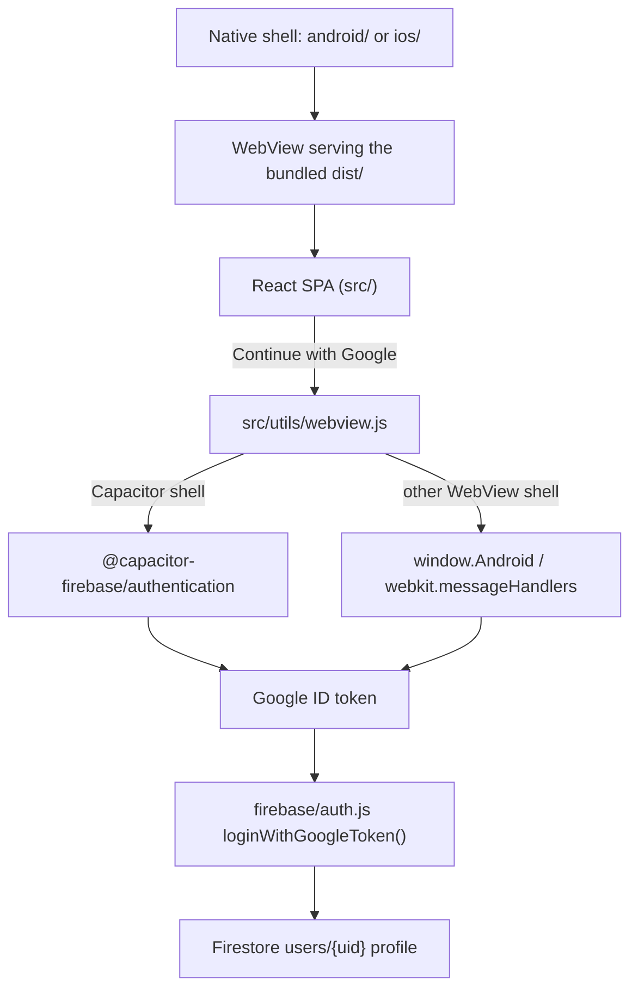

# BookmarkChat — iOS & Android apps

BookmarkChat ships to the App Store and Google Play as a Capacitor WebView shell around
this repository's web app. The web app is the product; the native projects in `android/`
and `ios/` add the things a browser cannot: native Google Sign-In, an app icon, a splash
screen, safe-area layout, and store distribution.

## Status

| Area | State |
| --- | --- |
| Web app (`src/`) | Complete, deployed at bookmarkchat.online |
| Native projects (`android/`, `ios/`) | Generated, wired, and synced — **not yet compiled on a device** |
| Native Google Sign-In | Wired end to end; needs Firebase credentials (below) to run |
| App icon / splash art | Still Capacitor defaults — needs branding (see Follow-ups) |
| Store submission | Not started — needs accounts, signing keys, and listings |

Nothing in `android/` or `ios/` has been built here: this checkout has no Android SDK,
JDK, or Xcode. Everything below marked "verified" was checked by running the command
shown; the native builds still need one pass on a machine with the toolchains.

## How the app is put together

The app bundles the compiled web build (`dist/`) inside the binary and serves it from a
local origin. It does **not** load bookmarkchat.online at runtime.

Consequence: shipping a web change requires a new app build and store release. This is
what both stores expect (a thin remote-URL wrapper is rejected under App Store review
guideline 4.2), but it means web deploys and app releases are separate events.



### Key files

| File | Role |
| --- | --- |
| `capacitor.config.json` | App id, plugin config: Google sign-in, splash, keyboard, system bars |
| `android/`, `ios/` | Generated native projects (committed; regenerate with `cap sync`) |
| `src/utils/webview.js` | Picks the sign-in route: Capacitor plugin, or a global bridge injected by another WebView shell |
| `src/firebase/auth.js` | `loginWithGoogleToken()` and the `window.bookmarkchatSignInWithGoogleTokens()` entry point both routes call |
| `src/firebase/config.js` | Uses IndexedDB persistence inside the native shell so the session survives app restarts |

## One-time credential setup (sign-in does not work without this)

Both platform config files below are gitignored: this repo keeps Firebase config out of
version control (same reason `.env` is ignored). Each developer and each build machine
needs its own copy.

1. **Firebase console → Authentication → Sign-in method → enable Google.**

2. **Android**
   - Project settings → add an Android app with package name `online.bookmarkchat.app`.
   - Register the SHA-1 fingerprint of the key you sign builds with. Register *two*: your
     local debug keystore, and the **Play App Signing** key from the Play Console. Google
     Play re-signs uploaded builds, so a release installed from Play fails Google sign-in
     unless the Play signing SHA-1 is registered too.
   - Download `google-services.json` → `android/app/google-services.json`.
   - The auth plugin reads the OAuth client from `R.string.default_web_client_id`, which
     the Gradle google-services plugin generates from that file. `android/app/build.gradle`
     already applies the plugin when the file is present.

3. **iOS**
   - Add an iOS app with bundle ID `online.bookmarkchat.app`.
   - Download `GoogleService-Info.plist` → `ios/App/App/GoogleService-Info.plist`.
   - In Xcode: target **App** → **Info** → **URL Types** → add one with **URL Schemes** set
     to the `REVERSED_CLIENT_ID` value from that plist. Without it the OAuth redirect never
     returns to the app.
   - No `AppDelegate` change is needed: Capacitor 8's generated `SceneDelegate` already
     forwards `openURLContexts` to `SceneDelegateProxy`, which delivers the redirect to the
     plugin.

4. **Then re-sync** so the native projects pick the config up: `npm run mobile:sync`.

The browser build is unaffected — it still uses the Firebase popup flow with the existing
`VITE_FIREBASE_*` environment variables.

## Build and run

Prerequisites: Node 20+ (24 is in use here), **JDK 21** and Android Studio for Android
(the template targets `compileSdk 36`), macOS with **Xcode 16.x** for iOS.

```bash
npm install

npm run mobile:sync      # vite build + cap sync (both platforms)
npm run mobile:android   # build, sync, then open Android Studio
npm run mobile:ios       # build, sync, then open Xcode (macOS only)
```

Then press Run ▶ in the IDE against a device or emulator. For live reload during native
development, `npx cap run android --livereload --external` (and the `ios` equivalent)
points the WebView at the Vite dev server instead of the bundled assets.

`npm run dev` still serves the plain web app in a browser; the native-only sign-in path is
exercised only inside the app shell.

### Version bumps

- Android: `versionCode` / `versionName` in [`android/app/build.gradle`](android/app/build.gradle).
- iOS: `MARKETING_VERSION` / `CURRENT_PROJECT_VERSION` in the Xcode target.

## Release

**Android** — create an upload keystore, configure `signingConfigs`, build with
`./gradlew bundleRelease` in `android/`, upload the AAB to the Play Console, enroll in Play
App Signing, then add the resulting app-signing SHA-1 to Firebase (see the trap above).

**iOS** — create the app record in App Store Connect, set up signing (automatic signing is
fine for a single team), archive in Xcode, and upload.

**Store metadata** — name, description, category (Music), screenshots (6.7" iPhone, plus
iPad if the app is listed for iPad), age rating, the Apple privacy manifest and Google data
safety form, and a privacy policy URL (`/privacy` already exists in the web app).

## What was verified here

Run and observed in this checkout:

- `npm run build` — succeeds.
- `npx eslint` on the web files touched by this change — clean. (The repo has ~750
  pre-existing lint errors elsewhere; none were introduced or fixed here.)
- `npx cap sync` — both platforms resolve all four plugins and regenerate the native
  dependency wiring (`android/app/capacitor.build.gradle`,
  `android/capacitor.settings.gradle`, `ios/App/CapApp-SPM/Package.swift`).
- `androidx.credentials` 1.3.0 confirmed present in Google's Maven index before pinning it.

**Not verified** — no native compilation, no run on a device or emulator, and no real
Google sign-in round trip. Those need the toolchains and credentials above. Treat the
first native build as the point where this becomes "done".

## Follow-ups / known gaps

1. **App icon and splash art** are still Capacitor's defaults on both platforms. Generate
   branded ones with `npx @capacitor/assets generate` from a 1024×1024 icon and a splash
   source, then re-sync. There are square 1024×1024 candidates in `public/` (for example
   `72A736BB-2659-41AE-8AC5-1EFDDB864A5A.png`) but they are camera-roll exports — pick the
   art deliberately rather than by filename.
2. **Background audio.** A music app should keep playing with the screen locked. iOS needs
   `UIBackgroundModes: [audio]` in `ios/App/App/Info.plist` plus activating an
   `AVAudioSession` with the `.playback` category in `AppDelegate`; Android needs a
   foreground service and media notification for reliable playback. Neither exists yet.
3. **In-app purchase.** The `Upgrade` page sells plans through Stripe. Apple requires
   StoreKit and Google requires Play Billing for digital goods bought inside an app, so the
   current flow will be rejected on iOS as-is. This is a product decision plus a code change,
   and it is the largest remaining blocker to an App Store release.
4. **Push notifications.** No plugin or web code exists; needs
   `@capacitor/push-notifications`, APNs/FCM setup, and something to send them.
5. **Android back button and in-app overlays.** `@capacitor/app` already makes the hardware
   back button walk WebView history and exit at the root, which is correct. The mobile menu
   overlay in `MobileBottomNav` does not close on back — add an
   `App.addListener('backButton', …)` that closes overlays before navigating.
6. **Deep links.** Not configured; links to bookmarkchat.online open in the browser rather
   than the app. Needs associated domains / App Links.
7. **iOS SPM traits.** The auth plugin's default SPM traits link the Facebook SDK even
   though only Google is used. To drop it, set
   `experimental.ios.spm.swiftToolsVersion` to `"6.1"` and
   `packageTraits: { "@capacitor-firebase/authentication": ["Google"] }` — this requires
   Capacitor CLI 8.3+, Xcode 16.3+, and a re-sync. If it stays linked, declare it in the
   privacy forms.
8. **Windows caveat.** `npx cap sync ios` cannot create the SPM symlink that
   `@capacitor-firebase/authentication` requires (Windows needs elevated privileges for
   symlinks). It prints an error, exits 0, and leaves `ios/App/CapApp-SPM/Package.swift`
   untouched. Run iOS sync on macOS.
